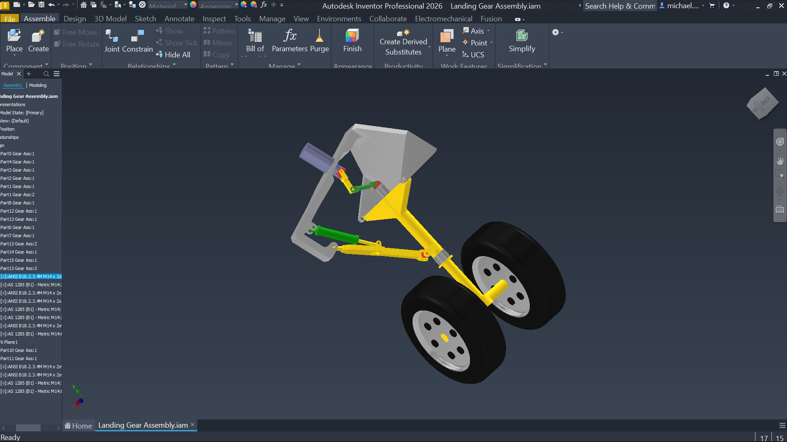

# Aircraft Landing Gear Assembly

## Project Overview
A comprehensive 3D mechanical CAD assembly of a retractable aircraft landing gear system, developed in Autodesk Inventor. The model demonstrates complex mechanical constraints, multi-part integration, and kinematic setup for aerospace structural components.

## Technical Details
* **Software:** Autodesk Inventor Professional
* **Key Features:**
  * Dual-wheel axle and structural main strut configuration.
  * Integrated hydraulic actuation and retraction cylinders.
  * Exported as `.STEP` for universal CAD compatibility and `.STL` for native GitHub 3D web viewing.
* **Author:** Michael Muchemi | Aerospace Engineering

## How to View
* **In Browser:** Click on the `.stl` file in the repository to interactively rotate and inspect the 3D model directly in GitHub's 3D viewer.
* **In CAD Software:** Download the `.step` file or the raw `.iam/.ipt` files to open the full assembly in SolidWorks, Fusion 360, CATIA, or Autodesk Inventor.
  
